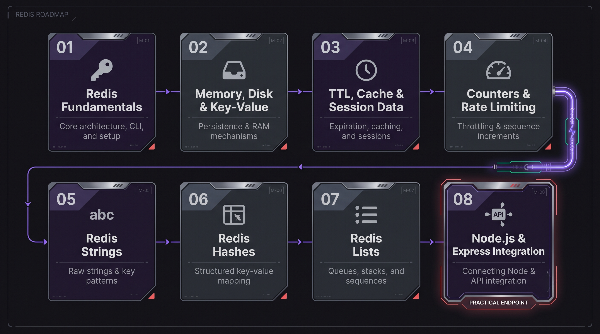
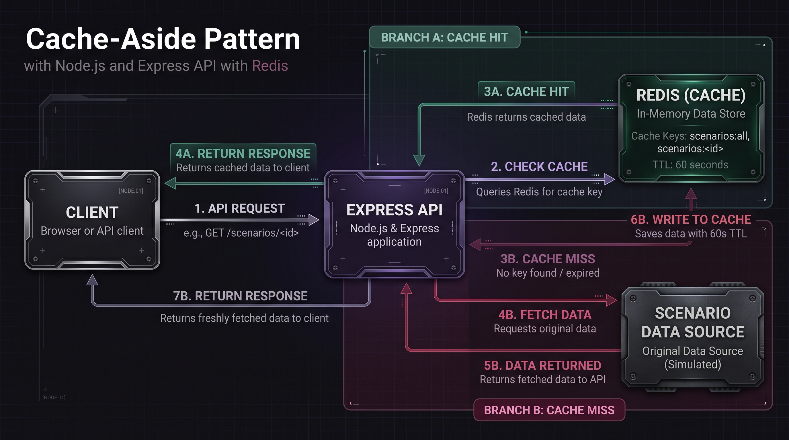

  

# Redis Learning

A hands-on journey into Redis, from the fundamentals to using it in a Node.js and Express application.

This folder contains the notes, commands, code examples, and experiments I worked through while learning Redis. Each chapter focuses on a specific concept and helps me understand how Redis works in practice.

<h2 align="center">Learning Roadmap</h2>

  

## Learning Roadmap

| Chapter | Topic |
|---|---|
| [01 — Redis Fundamentals](./01-redis-fundamentals/) | Core concepts, commands, and key-value operations |
| [02 — Memory, Disk & Key-Value](./02-memory-disk-key-value/) | Understanding memory, persistence, and how Redis stores data |
| [03 — TTL, Cache & Session Data](./03-ttl-cache-session-data/) | Key expiration, caching, and temporary data |
| [04 — Counters & Rate Limiting](./04-counters-rate-limiting/) | Incrementing counters and exploring request limits |
| [05 — Redis Strings](./05-redis-strings/) | Working with string values and their commands |
| [06 — Redis Hashes](./06-redis-hashes/) | Storing and managing structured field-value data |
| [07 — Redis Lists](./07-redis-lists/) | Working with ordered collections and list operations |
| [08 — Redis Integration](./08-redis-integration/) | Connecting Redis to Node.js and Express |

## Tools & Environment

- **Memurai** — Redis-compatible server running locally on Windows
- **Memurai CLI** — Running Redis commands and testing operations
- **Node.js** — Building backend examples
- **Express** — Creating API endpoints
- **Redis Node.js client (`redis`)** — Connecting the application to Redis

## Practical Work

The learning process includes testing Redis commands directly, observing key expiration, working with different data structures, and integrating Redis into an Express API.

In the integration chapter, I built a small scenario API and implemented **cache-aside caching** with a 60-second TTL. The API checks Redis for cached data before using the original data source, helping demonstrate cache hits, cache misses, and expiration.

<h2 align="center">Redis Cache-Aside Flow</h2>

  

The API checks Redis first. On a cache miss, it retrieves
the data from the source, stores the result in Redis with a
60-second TTL, and returns the response.

## Running the Examples

1. Clone the repository and navigate to the Redis directory.
2. Make sure Memurai is installed and running locally.
3. Open the chapter you want to explore.
4. Follow that chapter's README for its specific setup and execution instructions.

For Node.js examples, install the dependencies from the relevant chapter's `package.json` before running the application.

## Purpose

This is my personal Redis learning reference. It helps me revisit concepts, test what I've learned, and understand how Redis can be used in backend applications through practical examples.
